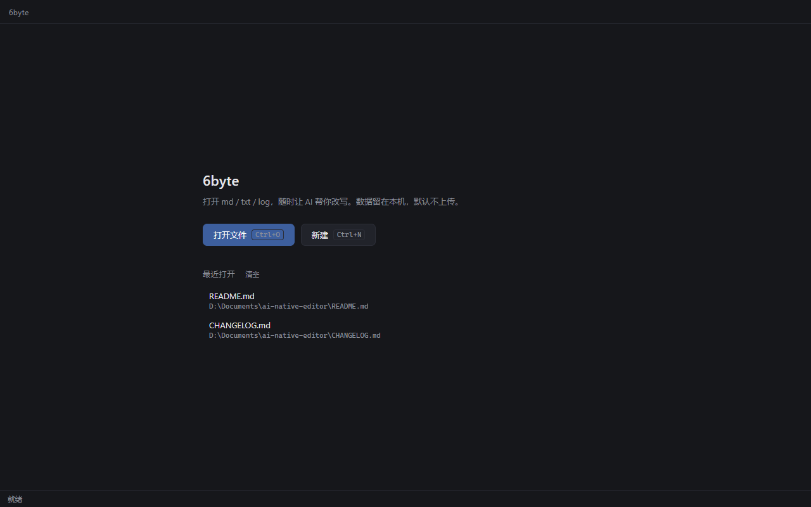
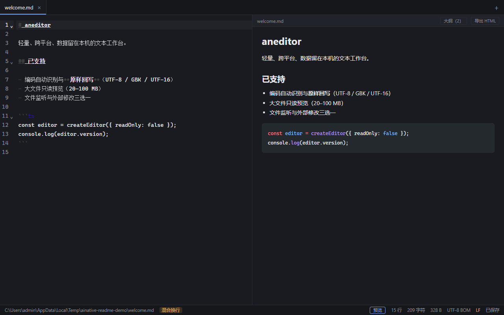
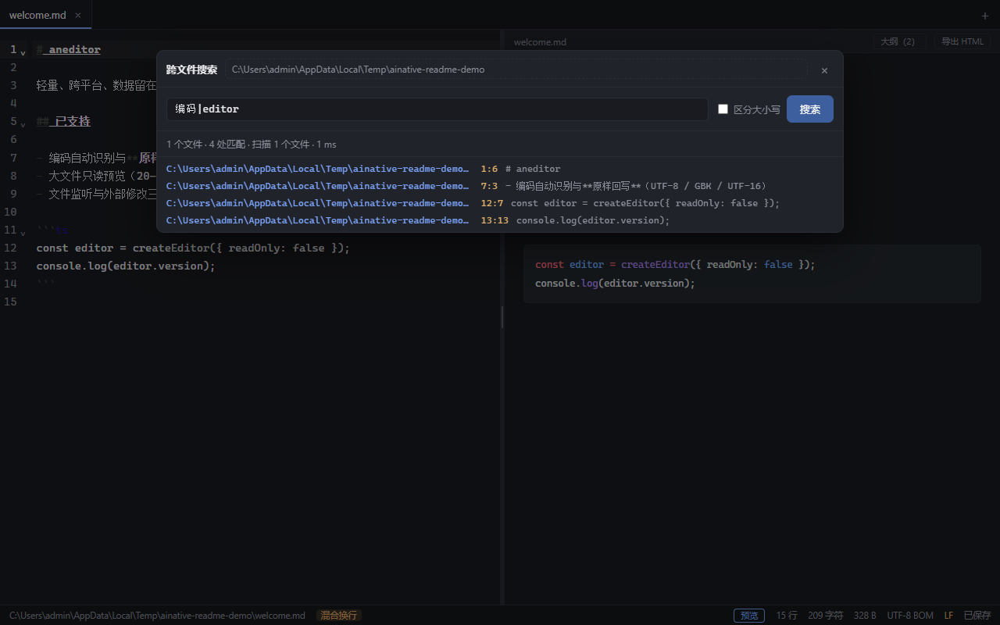
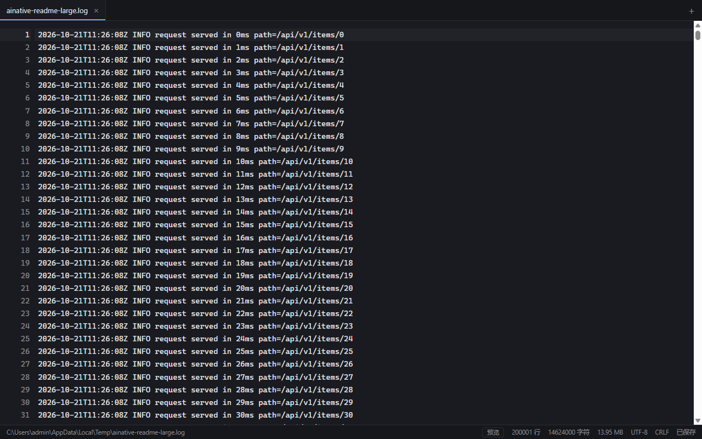

# 6byte

> A cross-platform, ultra-light, AI-native text workbench. Open `md` / `txt` / `log` and start writing — your data stays on your machine.

[](https://github.com/wufangqi/6byte/actions/workflows/ci.yml)
[](https://github.com/wufangqi/6byte/releases/latest)
[](./LICENSE)

[中文](./README.md) · **English**

**Current stage: M0–M2 shipped; M3 (model services, in-editor rewrite, autocomplete, .txt visual wrapping, top-right title-bar entries, UI consistency) shipped in v0.1.7.**

> The application UI is available in **Chinese and English** (switch under **View → Language**); the choice is remembered.
> The detailed docs under `docs/` are written in Chinese.

Roadmap & design notes: [技术选型与路线图.md](./技术选型与路线图.md) ·
Project review: [docs/项目梳理.md](./docs/项目梳理.md) ·
Backlog & progress: [docs/待办清单.md](./docs/待办清单.md) ·
UI guidelines: [docs/ui-guidelines.md](./docs/ui-guidelines.md) ·
Performance: [docs/perf.md](./docs/perf.md) ·
Release checklist: [docs/release-checklist.md](./docs/release-checklist.md) ·
Changelog: [CHANGELOG.md](./CHANGELOG.md)

---

## Screenshots

| Welcome | Editor + Markdown split preview |
|---|---|
|  |  |

| Cross-file search | Read-only large-file preview |
|---|---|
|  |  |

> Screenshots are captured from the installed app through the WebView2 DevTools protocol by `scripts/capture-screenshots.ps1` (1280×800).

## Tech stack

| Layer | Choice |
|---|---|
| Desktop runtime | Tauri 2 (system WebView, installers around 2 MB) |
| Frontend | React 19 + TypeScript + Vite 6 |
| Editor | CodeMirror 6 (multi-selection, folding, search panel, Markdown highlighting) |
| Markdown preview | markdown-it 15 (split view + scroll sync); KaTeX / Mermaid loaded on demand |
| Core (Rust) | Encoding detection & re-encoding (`encoding_rs` + `chardetng`), atomic save, file stat, large-file line index and range reads |
| State | zustand 5 |
| Quality | ESLint 10 + Prettier + Vitest + GitHub Actions (three platforms) |

## Install (end users)

Download from [Releases v0.1.7](https://github.com/wufangqi/6byte/releases/tag/v0.1.7):

- `6byte_0.1.7_x64-setup.exe` — NSIS, per-user install, no admin rights required (recommended)
- `6byte_0.1.7_x64_en-US.msi` — MSI, for enterprise deployment / silent install

Uninstall via "Settings → Apps" or `uninstall.exe` in the install directory.

## Development

```bash
# Requirements: Node 20+ / pnpm 11 / Rust stable + platform build tools (MSVC on Windows)
pnpm install

pnpm tauri dev        # desktop app (recommended)
pnpm dev              # UI only in a browser (no file I/O)
pnpm tauri build      # build installers → src-tauri/target/release/bundle/
```

Pre-commit checks:

```bash
pnpm exec tsc --noEmit && pnpm lint && pnpm format:check && pnpm test && pnpm build
cd src-tauri && cargo fmt --all -- --check && cargo clippy --all-targets -- -D warnings && cargo test --lib
```

End-to-end smoke test (needs the installed app plus a WebView2 remote-debugging port; exercises real UI paths):

```powershell
$env:WEBVIEW2_ADDITIONAL_BROWSER_ARGUMENTS = '--remote-debugging-port=9222'
Start-Process "$env:LOCALAPPDATA\6byte\6byte.exe"
powershell -NoProfile -ExecutionPolicy Bypass -File scripts/e2e-smoke.ps1
```

One-command pull request (local checks → commit → push → open PR → wait for 6 checks → squash merge):

```powershell
scripts\ship.ps1 -Title "feat: ..." -Body "description"
```

Releasing: pushing a `vX.Y.Z` tag triggers the `Release` workflow
(`.github/workflows/release.yml`), which builds the MSI/NSIS on Windows and attaches
them to a GitHub Release. Tag pushes create a **draft** by default; a manual
`workflow_dispatch` run with `publish: true` publishes directly. The workflow verifies
the tag against the three version manifests and takes the release notes from `CHANGELOG.md`.

> **Windows note**: `pnpm-workspace.yaml` sets `nodeLinker: hoisted`. Under the current Windows
> setup Node's ESM resolution does not follow pnpm's junction links, and the default isolated
> layout makes Vite fail with `Cannot find package 'picomatch'`. A flat `node_modules` avoids the
> problem at the cost of weaker dependency isolation.

## Verified

| Check | Command | Result |
|---|---|---|
| Frontend type check | `pnpm exec tsc --noEmit` | ✅ 0 errors |
| Lint / formatting | `pnpm lint`, `pnpm format:check` | ✅ pass |
| Frontend unit tests | `pnpm test` | ✅ 147/147 (store, format helpers, large-file window geometry, Markdown rendering/image paths, outline, scroll sync, HTML export, split ratio, themes, diagrams, i18n, title bar and preview state, per-tab undo history, model catalog without API keys, selection streaming, in-editor highlight accept/cancel, file names) |
| Frontend bundle | `pnpm build` | ✅ ~996 KB main / ~338 KB gzip (+ lazy Shiki, KaTeX and Mermaid chunks) |
| Rust unit tests | `cargo test --lib` | ✅ 75 passed / 0 failed (+4 ignored perf probes; 79 tests total; encoding, file commands, large-file index/range, watcher, grep, assets, folder scan, fixture corpus, OpenAI-compatible streaming, keychain and connectivity probe, edit-path timeout and retry, thinking text) |
| Rust formatting | `cargo fmt --all -- --check` | ✅ pass |
| Rust Clippy | `cargo clippy --all-targets -- -D warnings` | ✅ pass (locally needs `RUSTUP_TOOLCHAIN=stable-x86_64-pc-windows-msvc`, see docs/perf.md) |
| Installers | `pnpm tauri build` | ✅ MSI 5.70 MB / NSIS 4.88 MB (with KaTeX / Mermaid assets and the model client) |
| Install & launch | installed build (silent NSIS) | ✅ cold start median 0.094 s, close interception works |
| E2E smoke | `scripts/e2e-smoke.ps1` | ✅ 91/91 across 22 steps (large file, mixed EOL, session failures, external change reload, dirty conflict, grep jump, find & replace, Markdown preview, HTML export, outline jump, image paste, Shiki, draggable split, recent-file delete, title-bar menus, theme switching + persistence, per-file preview, Mermaid/KaTeX, light-theme repaint, Chinese/English switch + persistence, undo history across tab switches and preview toggles) |
| Three-platform CI | GitHub Actions | ✅ `CI` green (Windows / macOS / Ubuntu × frontend + Rust) |
| Release automation | tag push → `Release` workflow | ✅ real run for v0.1.7 (run 40111156255): Windows MSI/NSIS → draft release → published after review; `check-version` guards the manifests |

## Performance (honest numbers, details in [docs/perf.md](./docs/perf.md))

| Metric | Budget | Measured |
|---|---|---|
| Cold start | ≤ 1.5 s | **0.094 s** (median of 20 runs, Win11 / i5-1335U) |
| 10 MB open (Rust read + decode) | ≤ 500 ms | **14.1 ms** (end-to-end through CodeMirror not measured) |
| 100 MB line index | ≤ 150 ms | **64.6 ms** (1.54 M lines, first index build) |
| Cross-file grep (1000 files) | ≤ 2 s | **64.5 ms** |
| 35 MB open to first paint (read-only) | ≤ 1 s | **458 ms** (including app startup, measured via CDP) |
| Input latency P95 | ≤ 16 ms | **5.6 ms** (1000-line L0); L1: 10 MB **3.0 ms**, 19 MB **2.7 ms** |
| Memory with 3 files | ≤ 260 MB (idle baseline ≤ 230 MB) | ⚠️ idle private memory **220 MB** (WebView2 baseline); down to 159 MB with GPU disabled (see perf.md) |
| Installer | ≤ 20 MB | ✅ 4.88 MB (NSIS, current build) |

## Implemented

- [x] Open / save / save-as (Ctrl+O / Ctrl+S / Ctrl+Shift+S), new (Ctrl+N), close (Ctrl+W)
- [x] Tabs, dirty marker, middle-click close, drag & drop files onto the window
- [x] Session restore and recent files (12 entries, with per-item delete and clear-all)
- [x] Encoding detection: UTF-8 / UTF-8 BOM / UTF-16LE / UTF-16BE / chardetng guesses (incl. GBK)
- [x] **Write-back with the original encoding / BOM / line endings**, plus a confirmation when a lossily decoded file would be overwritten
- [x] Atomic save (temp file + rename, falls back on failure)
- [x] External-modification detection (stat comparison, three-way conflict dialog)
- [x] Staged large files: ≤5 MB full editing; 5–20 MB with reduced decorations; 20–100 MB read-only virtual scrolling preview
      (Rust line-offset index + range reads, 400 lines per request; 35 MB to first paint in 458 ms); >100 MB rejected with a clear message
- [x] Binary protection (64 KB NUL sniff, UTF-16 BOM exempt)
- [x] Mixed line endings: status-bar badge and a confirmation that normalizes to the dominant EOL on save
- [x] Cross-file search (Ctrl+Shift+F): Rust `regex` over a directory tree, skips binary files and dependency folders, click a hit to jump
- [x] External-change watching (`notify`, parent-directory watch): silently reloads clean tabs, offers keep-mine / load-from-disk / later for dirty ones
- [x] Session restore skips missing files with a single summary notice (and drops them from the session)
- [x] Dirty-tab and window-close interception (save / discard / cancel)
- [x] CodeMirror 6 search panel (Ctrl+F, regex and capture-group replacement, bilingual)
- [x] Markdown split preview (Ctrl+Shift+M or the status-bar "预览" button): markdown-it rendering, 120 ms debounced live updates, two-way proportional scroll sync, external-link interception; **draggable divider** (double-click resets to 50/50, arrow keys nudge)
- [x] HTML export: one click in the preview toolbar, self-contained (inline styles, no external assets), written next to the source file by default
- [x] Outline panel: stable heading anchors + an "大纲 (N)" popover that scrolls the preview to the chosen heading
- [x] Image paste: pasting an image stores it under `assets/` and inserts a Markdown reference; previews inline it as a data URI
- [x] Mermaid diagrams and KaTeX math in the preview (loaded on demand). A diagram that fails to parse stays a code block; a formula that fails stays as written
- [x] Cross-file search panel (Ctrl+Shift+F, regex + case toggle + click-to-jump)
- [x] Custom title bar: File and View menus, window controls, app icon
- [x] Themes: light / dark / follow system (persisted); editor, preview, Shiki, Mermaid and exported HTML follow the theme
- [x] Per-file Markdown preview: each tab remembers its own toggle; reopening a file starts in edit mode
- [x] Open folder (up to 40 text files at once) and new windows with an empty session
- [x] Mermaid diagrams and KaTeX math in the preview, loaded on demand
- [x] Bilingual UI (Chinese / English): menus, status bar, search, preview and dialogs; switch under View → Language, persisted in `localStorage` (`ainative.locale`)
- [x] Undo history kept per tab (M-06): all tabs share one `EditorView` while each tab keeps its own `EditorState`; switching tabs or toggling the preview no longer resets undo history, and switching back restores the undo stack, caret and scroll position
- [x] Model service has two levels: providers (address and API key), then models under a provider. The key is stored per provider. Top-right title bar **Model**
- [x] Selection rewrite: status-bar **Model**. Instruction on the left, collapsible thinking on the right. The reply streams into the current editor and is highlighted. Accept replaces the original and does not save the file; Cancel restores it. Cancels if no event arrives within 15 seconds; retries 429/5xx twice
- [x] Quick actions: **Polish / Translate / Summarize** at the top of the model panel send immediately for the selection (one undo, nothing saved); the instruction box shows the prompt that was sent
- [x] Autocomplete: off by default, its model is configured separately from rewrite. A suggestion appears after a short pause; Tab accepts, Esc cancels, nothing is saved. Completion, model and model-service entries live in the top-right title bar
- [x] `.txt` files and untitled notes wrap visually (display only, no newline is written); markdown / log / json keep their original lines
- [x] Open folder (up to 40 text files at once) and new windows with an empty session
- [x] Cross-file search panel (Ctrl+Shift+F, regex + case toggle + click-to-jump)

## Not implemented yet (M2 → M4)

- [ ] Incremental / cached cross-file grep (if needed for M2)
- [ ] AI editing: Ctrl+K inline diff and Tab accept (M3). Inline rewrite works in the editor; only the shortcut is missing
- [ ] Portable build, winget, auto-update, Explorer context menu (M4)

## Project layout

```
src/                  React frontend
  editor/             CodeMirror wrapper, extensions, one shared view + per-tab EditorState (only place importing @codemirror/*)
  features/           title bar menus / theme / tab bar / status bar / welcome / dialogs / large-file viewer / grep panel / Markdown preview, export, outline, image paste, diagrams
  i18n/               message catalogs (zh/en), locale state, Rust error localisation
  ipc/                typed wrappers for every Tauri command and event (only place importing @tauri-apps/*)
  stores/             zustand state
  lib/                pure helpers
src-tauri/            Rust core
  src/codec.rs        encoding detection and re-encoding (with unit tests)
  src/bigfile.rs      large-file staging, line index, range reads (with unit tests)
  src/watcher.rs      file watching (notify, parent-directory watch + event dedupe, with unit tests)
  src/grep.rs         cross-file search (regex, skips binaries and dependency folders, with unit tests)
  src/ai.rs           model provider, OpenAI-compatible streaming, cancellation, connectivity probe (unit tests)
  src/secrets.rs      API key in the OS keychain (in-memory stand-in for tests; nothing is written to a config file)
  src/commands.rs     file read/write, stat, atomic save, open_document, grep_files, watch_file, asset save, large-file/binary guards
  capabilities/       Tauri permissions (minimal set)
scripts/
  e2e-smoke.ps1       CDP-driven end-to-end smoke test
  capture-screenshots.ps1  CDP-driven README screenshots
  gen_icons.py        icon generation
.github/workflows/    CI (three-platform frontend checks + Rust fmt/clippy/test)
docs/                 project review, backlog, performance, release checklist
```

## Known limitations

- Preview highlighting covers 10 common languages; other languages fall back to plain text.
- Pasted images are stored in `assets/` next to the source file; previews read them through the Tauri asset protocol (read-only).
- HTML export defaults to a same-named `.html` next to the source file and overwrites it on re-export.
- The dirty flag only grows: undoing back to the saved state still shows unsaved.
- Files with mixed line endings are normalized to the dominant EOL on save (confirmed first).
- Files of 20–100 MB open in read-only preview and cannot be edited/saved yet.
- Files over 100 MB open as a read-only memmap preview (512 MB cap).
- "Save as" onto a path that is already open switches to that tab instead of duplicating it.
- No auto-update, no portable build (M4).

## Contributing

See [CONTRIBUTING.md](./CONTRIBUTING.md) (directory rules, test requirements, commit conventions, release process; in Chinese).

## License

[MIT](./LICENSE)
