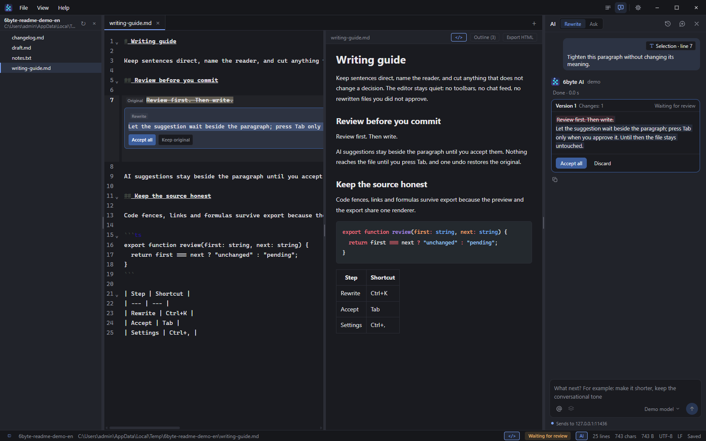
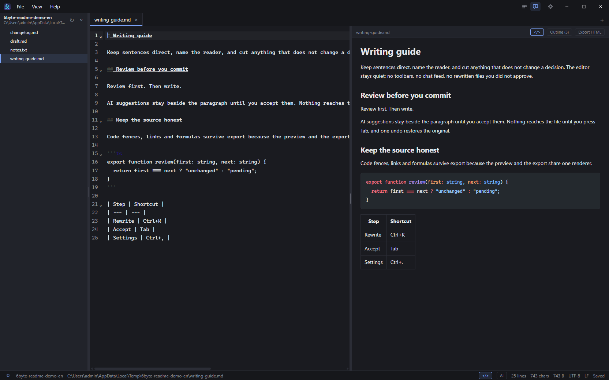
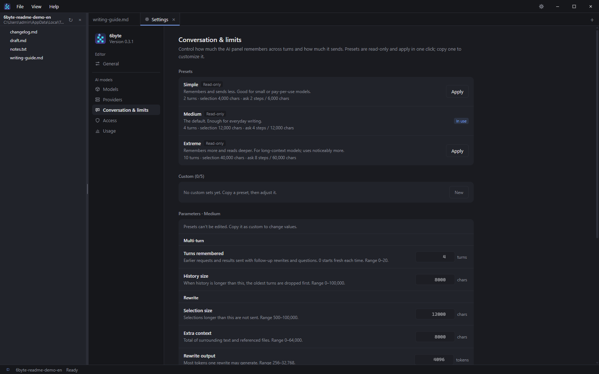

# 6byte

**A local-first, keyboard-driven editor with an AI path you can review.**

Open `md` / `txt` / `log` and start writing. Your files and AI keys stay on your machine; suggestions sit beside the paragraph and never touch the file until you accept them.

[](https://github.com/wufangqi/6byte/actions/workflows/ci.yml)
[](https://github.com/wufangqi/6byte/releases/latest)
[](./LICENSE)

[中文](./README.zh.md) · **English**

**Current release: v0.3.1** (2026-10-30) — Windows, Linux and macOS installers.



*`Ctrl+K` on a paragraph: the rewrite waits inline and in the AI panel. `Tab` accepts, `Esc` cancels, one undo restores the original.*

## Why 6byte

Most editors either treat AI as a chat sidebar that cannot touch the document, or let it rewrite files you never saw. 6byte takes the middle path:

- **Review before write.** A candidate is a visual proposal, not a save. Nothing reaches the file until you press **Tab** or click Accept; block-level diffs let you keep only the changes you approve.
- **Big files are still files.** Up to 5 MB edits normally; 5–20 MB keeps a lighter decoration set; 20–100 MB gets read-only virtual scrolling; over 100 MB opens a read-only memmap view. You do not have to split a large log to read it.
- **Byte-honest.** UTF-8 / BOM / UTF-16 / GBK detection, write-back with the original encoding and line endings, atomic save, external-change detection and a three-way conflict dialog.
- **Markdown first, export faithful.** Open `.md` rendered by default; code highlighting, diagrams, formulas and local images are rendered by the same pipeline as HTML export.
- **Keyboard-first and light.** Tauri 2 with the system WebView: ~5 MB installers, ~0.1 s cold start, no background services.
- **Local by default.** AI keys live in the OS keychain, requests go straight to the endpoint you configure, conversation history and usage counters stay in local storage, and there is no telemetry.

## The editor



- **Workspace tree**: open one folder; folders expand lazily one level per click, never scanning the whole tree. Hidden names, dependency folders and symlinks stay out. `Ctrl+Shift+E` toggles it; the collapsed state survives restarts.
- **Tabs & history**: session restore, recent files, per-tab undo history, drag & drop, middle-click close, rename from the tab context menu or `F2`.
- **Search**: `Ctrl+F` find & replace with regex and capture groups; `Ctrl+Shift+F` cross-file grep across the workspace (skips binaries and dependency folders).
- **Markdown**: rendered by default; `<>` / `Ctrl+Shift+M` reveals the source beside it. Outline, draggable split, Mermaid zoom / pan / reset (25–300%), KaTeX, Shiki, image paste, and HTML export in the File menu or command palette.
- **Long Markdown**: documents over 80k characters render a ~24k-character window around the reading position instead of the whole file; code fences are never cut in half. Measured scroll and memory numbers are in [docs/perf.md](./docs/perf.md).
- **UI**: Chinese / English, light / dark / follow system, custom title bar. `.txt` and untitled notes wrap automatically.

## AI you can control



- **Inline review**: select text, `Ctrl+K`, describe the change. The candidate sits beside the paragraph and in the right-hand AI panel; `Tab` or **Accept** replaces it, `Esc` or **Discard** keeps the original. Block-level review applies only the hunks you accept.
- **Conversation & limits**: built-in Simple / Medium / Extreme presets plus up to five custom sets. Control remembered turns, history size, selection and context limits, rewrite/ask token budgets, and ask steps. The panel keeps the last 30 local conversations and can start, switch or delete them.
- **Workspace context**: `Ctrl+P` command palette, `@` references in the rewrite box, outline-aware context, and a read-only ask mode that can list folders, grep, read ranges and outline — it cannot write files or read hidden/key files you excluded.
- **One-click actions**: Polish / Translate / Summarize on a selection; follow-up prompts ("shorter", "more formal") reuse the previous candidate.
- **Preview selection**: select text in the rendered Markdown preview to rewrite the matching source range.
- **Keys stay local**: providers and models are configured in Settings (`Ctrl+,`); API keys go to the OS keychain and are bound to the saved origin. Non-local endpoints must use HTTPS.
- **Autocomplete is off by default**; when enabled it uses a separate completion model and Tab accepts, Esc dismisses.

## Install

Download from [Releases](https://github.com/wufangqi/6byte/releases/latest):

**Windows**

- `6byte_0.3.1_x64-setup.exe` — NSIS, per-user install, no admin rights (recommended)
- `6byte_0.3.1_x64_en-US.msi` — MSI for enterprise / silent install

**Linux**

- `6byte_0.3.1_amd64.deb` — Debian / Ubuntu: `sudo apt install ./6byte_0.3.1_amd64.deb`
- `6byte_0.3.1_amd64.AppImage` — portable: `chmod +x 6byte_0.3.1_amd64.AppImage && ./6byte_0.3.1_amd64.AppImage`

Needs WebKitGTK 4.1 (`libwebkit2gtk-4.1-0` on Ubuntu 22.04+ / Debian 12+).

**macOS**

- `6byte_0.3.1_universal.dmg` — universal (Apple Silicon + Intel). The build is unsigned and not notarized: right-click → **Open** the first time, or run `xattr -dr com.apple.quarantine /Applications/6byte.app`.

Uninstall via "Settings → Apps" or `uninstall.exe` in the install directory.

## Build

```bash
# Requirements: Node 20+ / pnpm 11 / Rust stable + platform build tools (MSVC on Windows)
pnpm install
pnpm tauri dev      # desktop app
pnpm tauri build    # installers → src-tauri/target/release/bundle/
```

Full commands, directory rules, commit conventions and the release process live in [CONTRIBUTING.md](./CONTRIBUTING.md).

## Verified

- Frontend **307** unit tests across 53 files; Rust **113** tests (+4 ignored); preview benchmark **3/3**.
- Installed-build E2E **107/107 across 24 steps** and AI E2E **6/6** on the 0.3.0 release build (Windows, 2026-10-29).
- Real Ollama (0.40.11, `qwen2.5:1.5b`) exercised the rewrite and ask paths end to end.
- CI runs the same checks on Windows, macOS and Ubuntu.

Performance data, including long-Markdown scroll and memory measurements, is in [docs/perf.md](./docs/perf.md).

## Known limitations

- 20–100 MB files are read-only; over 100 MB opens as a read-only memmap preview (≤512 MB). Neither can be edited or saved.
- The dirty flag only grows: undoing back to the saved state still shows unsaved.
- Files with mixed line endings are normalized to the dominant EOL on save (confirmed first).
- AI requires your own OpenAI-compatible endpoint and API key.
- No auto-update, no portable build and no Explorer context menu yet (M4).
- The file tree is read-only: no create or delete, no Git status, no whole-tree watch (open files are watched), symlinks are skipped, and one folder lists at most 2000 entries. Rename files from the tab context menu or `F2`.
- The custom title bar has only been verified on Windows; Linux and macOS installers are built by CI but have not been smoke-tested on real machines yet.

## Deliberately not doing

6byte stays an editor with a reviewable AI path, not a platform. It will not add WYSIWYG/rich-text editing, a knowledge graph, a plugin system, real-time collaboration, a general-purpose chat sidebar, or autonomous cross-file writes. Those would trade review-before-write for scope we cannot verify.

## Roadmap

Manual acceptance on Windows / Linux / macOS (M-07) and distribution expansion (M4: portable build, a package-manager channel, auto-update, Explorer context menu) are next. Details and progress live in [docs/待办清单.md](./docs/待办清单.md).

## Docs

- [Roadmap & design notes](./技术选型与路线图.md) (Chinese)
- [Backlog & progress](./docs/待办清单.md) · [Changelog](./CHANGELOG.md)
- [Performance](./docs/perf.md) · [Release checklist](./docs/release-checklist.md)
- [UI guidelines](./docs/ui-guidelines.md) · [Project review](./docs/项目梳理.md) · [Workspace tree PRD](./docs/PRD-工作区文件树.md)
- [Contributing](./CONTRIBUTING.md)

## License

[MIT](./LICENSE)
