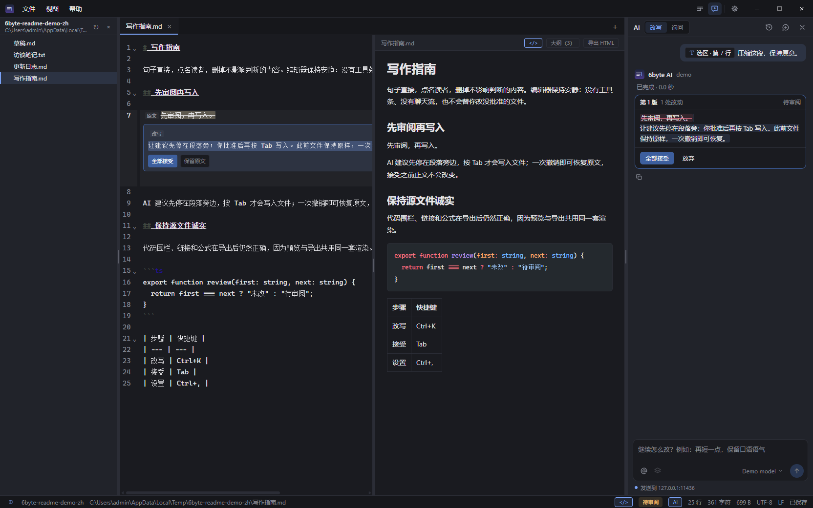
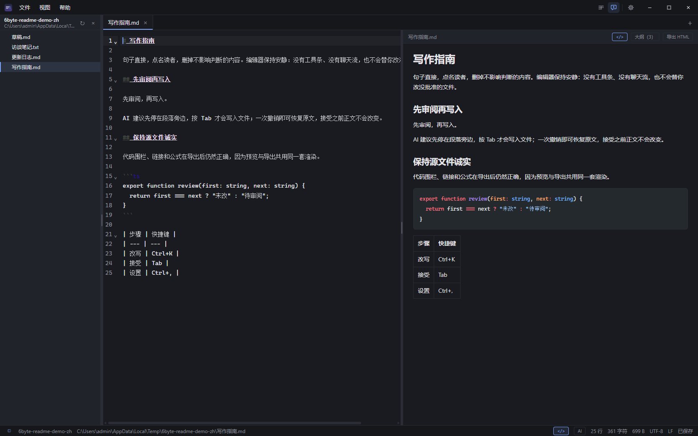
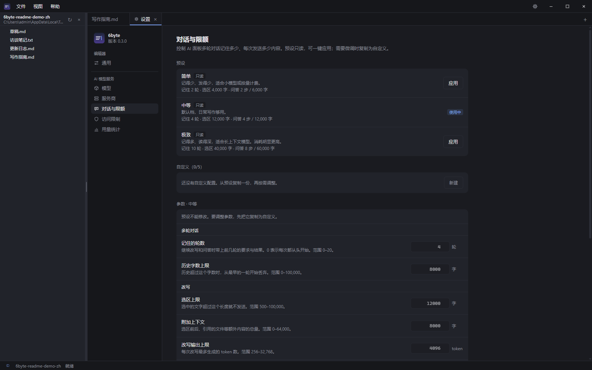

# 6byte

**本地优先、键盘优先的编辑器，AI 改动先审阅再写入。**

打开 `md` / `txt` / `log` 就能写。文件和 AI 密钥留在本机；建议先停在段落旁边，你接受之前不会碰文件。

[](https://github.com/wufangqi/6byte/actions/workflows/ci.yml)
[](https://github.com/wufangqi/6byte/releases/latest)
[](./LICENSE)

**中文** · [English](./README.md)

**当前版本：v0.3.0**（2026-10-29），Windows、Linux、macOS 安装包齐全。



*在段落上按 `Ctrl+K`：候选同时停在编辑器内联和右侧 AI 面板。`Tab` 接受，`Esc` 取消，一次撤销恢复原文。*

## 为什么是 6byte

多数编辑器要么把 AI 做成碰不到文档的聊天侧栏，要么直接改你没看过的文件。6byte 走中间那条路：

- **先审阅再写入。** 候选只是可视化建议，不是保存。按 **Tab** 或点「接受」之前，正文不变；逐块 diff 允许只保留你同意的改动。
- **大文件仍然是文件。** 5 MB 以内正常编辑；5–20 MB 用更轻的装饰；20–100 MB 只读虚拟滚动；超过 100 MB 走只读 memmap。不必为了看一段日志先切分文件。
- **对字节诚实。** UTF-8 / BOM / UTF-16 / GBK 检测，按原编码与换行回写，原子保存，外部修改检测与冲突三选一。
- **Markdown 优先，导出不走样。** 打开 `.md` 默认渲染；代码高亮、图表、公式和本地图片与 HTML 导出共用同一套渲染。
- **键盘优先、足够轻。** Tauri 2 + 系统 WebView：安装包约 5 MB，冷启动约 0.1 s，没有后台常驻服务。
- **默认留在本机。** AI 密钥进系统钥匙串，请求直连你配置的服务；会话历史与用量只存本机，不做遥测。

## 编辑器



- **工作区文件树**：打开一个文件夹，目录按需逐层展开，不扫描整棵树。隐藏名、依赖目录和符号链接不列出。`Ctrl+Shift+E` 开关，折叠状态重启后保持。
- **标签与历史**：会话恢复、最近文件、按标签保留撤销历史、拖拽打开、中键关闭，标签右键或 `F2` 重命名。
- **搜索**：`Ctrl+F` 查找替换（正则、捕获组）；`Ctrl+Shift+F` 跨文件 grep（跳过二进制与依赖目录）。
- **Markdown**：默认渲染，`<>` / `Ctrl+Shift+M` 在旁边显示源码；大纲跳转、可拖分栏、Mermaid 缩放 / 平移 / 重置（25%–300%）、KaTeX、Shiki、图片粘贴，文件菜单和命令面板都能导出 HTML。
- **长 Markdown**：超过 8 万字符只渲染阅读位置附近约 2.4 万字符，代码围栏不从中间切开；滚动与内存实测见 [docs/perf.md](./docs/perf.md)。
- **界面**：中英双语、深色 / 浅色 / 跟随系统、自定义标题栏；`.txt` 与未命名笔记自动换行。

## 可控的 AI



- **内联审阅**：选中文字按 `Ctrl+K` 写要求，候选同时停在段落旁和右侧 AI 面板；`Tab` / **接受**替换，`Esc` / **放弃**保留原文；逐块审阅只应用你同意的块。
- **对话与限额**：简单 / 中等 / 极致三档预设，另可建最多五套自定义；控制记住轮数、历史字数、选区与上下文上限、改写 / 询问 token 预算和询问步数。面板在本机保留最近 30 段会话，可新建、切换、删除。
- **工作区上下文**：`Ctrl+P` 命令面板；改写框输入 `@` 引用文件；只读询问可以列目录、搜索、按行读取、读大纲，但不能写文件，也不能读你排除的隐藏 / 密钥文件。
- **一键动作**：选中文字润色 / 翻译 / 总结；追问「再短一点」「更正式」会沿用上一版候选。
- **预览选区**：在渲染后的 Markdown 里选中文字，也能映射回源码范围发起改写。
- **密钥留在本机**：服务商与模型在设置（`Ctrl+,`）里配置；API Key 进系统钥匙串并绑定保存时的源站，非本机地址只接受 HTTPS。
- **自动补全默认关闭**；开启后使用单独的补全模型，`Tab` 接受、`Esc` 取消。

## 安装

从 [Releases](https://github.com/wufangqi/6byte/releases/latest) 下载：

**Windows**

- `6byte_0.3.0_x64-setup.exe` — NSIS，单用户安装，无需管理员权限（推荐）
- `6byte_0.3.0_x64_en-US.msi` — MSI，适合企业部署 / 静默安装

**Linux**

- `6byte_0.3.0_amd64.deb` — Debian / Ubuntu：`sudo apt install ./6byte_0.3.0_amd64.deb`
- `6byte_0.3.0_amd64.AppImage` — 免安装：`chmod +x 6byte_0.3.0_amd64.AppImage && ./6byte_0.3.0_amd64.AppImage`

依赖 WebKitGTK 4.1（Ubuntu 22.04+ / Debian 12+ 的 `libwebkit2gtk-4.1-0`）。

**macOS**

- `6byte_0.3.0_universal.dmg` — 通用包（Apple Silicon + Intel）。未签名、未公证：首次打开需右键 →「打开」，或执行 `xattr -dr com.apple.quarantine /Applications/6byte.app`。

卸载走「设置 → 应用」，或安装目录里的 `uninstall.exe`。

## 构建

```bash
# 需要 Node 20+ / pnpm 11 / Rust stable 与平台构建工具（Windows 用 MSVC）
pnpm install
pnpm tauri dev      # 桌面应用
pnpm tauri build    # 安装包 → src-tauri/target/release/bundle/
```

完整命令、目录约束、提交规范与发布流程见 [CONTRIBUTING.md](./CONTRIBUTING.md)。

## 验证

- 前端 **303** 个单测（52 文件），Rust **112**（+4 ignored），预览基准 **3/3**。
- 0.3.0 发布构建上，安装版 E2E **107/107（24 步）**、AI E2E **6/6**（Windows，2026-10-29）。
- 真实 Ollama（0.40.11，`qwen2.5:1.5b`）端到端跑过改写与询问。
- CI 在 Windows、macOS、Ubuntu 上跑同一套检查。

性能与长 Markdown 的滚动 / 内存实测见 [docs/perf.md](./docs/perf.md)。

## 已知限制

- 20–100 MB 只读；超过 100 MB 走 memmap 只读（≤512 MB），都不能编辑保存。
- 脏标记只增不减：撤销回保存点仍显示未保存。
- 混合换行文件保存时统一为主导 EOL（保存前确认）。
- AI 需要自备 OpenAI 兼容服务与 API Key。
- 暂无自动更新、便携版与资源管理器右键（M4）。
- 文件树只读：不能在树里新建或删除，不显示 Git 状态，不监听整棵目录（只监听已打开的文件），跳过符号链接，单层最多 2000 项；文件可在标签右键或 `F2` 重命名。
- 自定义标题栏只在 Windows 验证过；Linux / macOS 安装包由 CI 构建，尚未在真机冒烟。

## 明确不做

6byte 保持「可审阅的编辑器 + AI」，不做平台：不做 WYSIWYG / 富文本、知识图谱、插件系统、实时协作、通用聊天侧栏，也不做跨文件自治写入。这些会拿「先审阅再写入」换取无法验证的范围。

## 路线图

下一步是 Windows / Linux / macOS 人工验收（M-07）与分发扩张（M4：便携版、至少一个包管理器渠道、自动更新、资源管理器右键）。细节与进度见 [docs/待办清单.md](./docs/待办清单.md)。

## 文档

- [技术选型与路线图](./技术选型与路线图.md)
- [待办与进度](./docs/待办清单.md) · [更新日志](./CHANGELOG.md)
- [性能](./docs/perf.md) · [发布清单](./docs/release-checklist.md)
- [UI 规范](./docs/ui-guidelines.md) · [项目梳理](./docs/项目梳理.md) · [工作区文件树 PRD](./docs/PRD-工作区文件树.md)
- [贡献指南](./CONTRIBUTING.md)

## 许可证

[MIT](./LICENSE)
