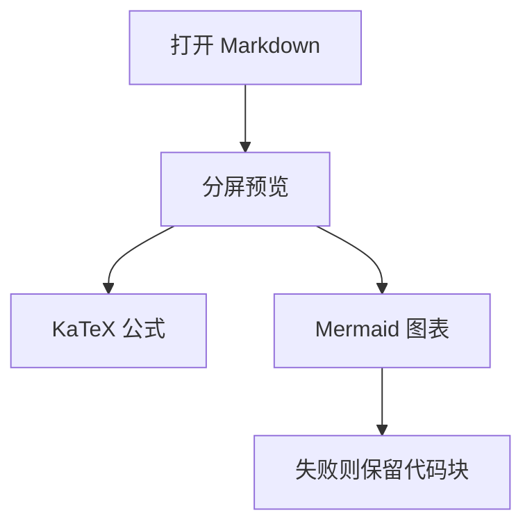

# 6byte 预览测试

用 **Ctrl+Shift+M** 或状态栏「预览」打开分屏。下面每节写了预期结果。

## 正文

这是一段普通文字，包含 **粗体**、*斜体* 和 `行内代码`。

> 引用块应有左侧色条。

- 无序列表一
- 无序列表二

1. 有序列表一
2. 有序列表二

裸链接应可识别，但点击后只提示、不跳转：https://example.com

下面的标签必须显示成文字，不能执行：

<script>alert("x")</script>

| 功能 | 预期 |
|---|---|
| 大纲 | 能列出本文标题，点击跳到对应位置 |
| 导出 | 「导出 HTML」写到本文件同目录 |

## 公式

行内公式：$E = mc^2$，以及段内公式 $$a^2 + b^2 = c^2$$。

独立一块：

$$
\int_0^1 x^2 \, dx = \frac{1}{3}
$$

金额不要变成公式：price is $5 and $10 today。

无法解析时应原样留下：$\notacommand$。

行内代码里的美元也不要变成公式：`$x$`。

## 图表

下面应渲染成流程图。



下面不是合法图表，应仍显示为代码块。

```mermaid
this is not a diagram
```

## 代码高亮

JavaScript 应有语法色：

```js
const ready = 1 < 2 && "preview";
console.log(ready);
```

未支持的语言保持纯文本：

```go
fmt.Println("plain")
```

## 图片

相对路径图片应显示在预览里（本文件在 `docs/` 下）。


## 大纲用的重复标题

## 大纲用的重复标题

两个同名标题都应出现在大纲里，锚点分别是 `大纲用的重复标题` 和 `大纲用的重复标题-1`。
